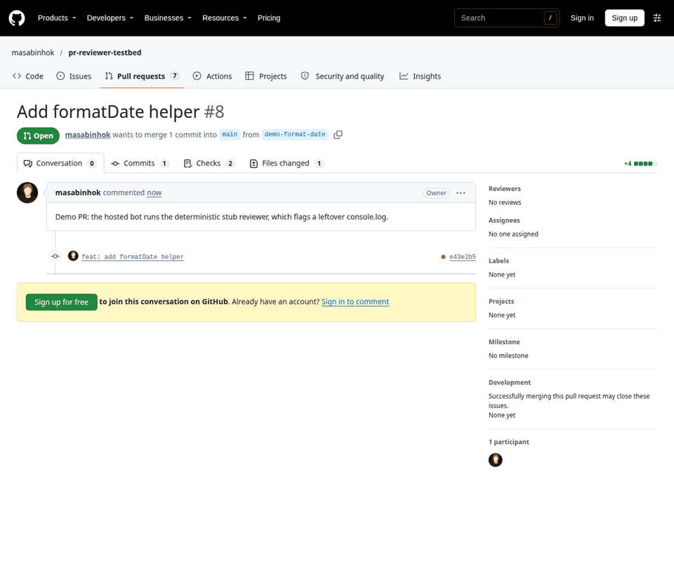
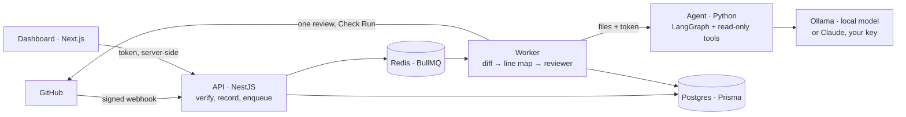

# pr-reviewer

A GitHub App that reviews pull requests with an LLM agent, posts only line-anchored findings it
can justify, and measures itself against 29 real bugs.

**[Live dashboard](https://pr-reviewer-teal.vercel.app)** ·
**[See it on a pull request](https://github.com/masabinhok/pr-reviewer-testbed/pull/8)** ·
**[The local model's real comments](https://github.com/masabinhok/pr-reviewer-testbed/pull/6/files)** ·
**[Install the demo App](https://github.com/apps/pr-reviewer-demo-1)**



*Screenshots of [testbed PR #8](https://github.com/masabinhok/pr-reviewer-testbed/pull/8) and the live dashboard, taken as it was reviewed.*

> **What the live demo runs.** The hosted App uses the deterministic **stub reviewer**, which flags
> `console.log`, `debugger` and new `TODO`s. No free host runs the model. Everything else is the
> real pipeline. The AI reviewer, a LangGraph agent on a local 7B model, runs on a GPU. Its real
> comments are on [testbed PR #6](https://github.com/masabinhok/pr-reviewer-testbed/pull/6), and
> its September reviews are in the dashboard's
> [Reviews](https://pr-reviewer-teal.vercel.app/reviews) list.

## What it guarantees

- **Only signed deliveries.** `X-Hub-Signature-256` is checked over the raw request body. A
  delivery that is tampered with or unsigned gets a 401 and writes nothing.
- **Each delivery handled once.** Every webhook is recorded before it is processed, so GitHub's
  redeliveries are dropped.
- **Every comment lands on a line GitHub accepts.** The diff is parsed into a map of commentable
  lines, and a finding that falls outside it is dropped.
- **A second look before posting.** Each finding is re-checked in a fresh conversation against the
  code around it. Refuted findings are dropped, and unconfirmed ones are demoted.
- **Posted exactly once.** The review and its comments go up once, however the job is retried.
  A later push never re-posts a comment already on the pull request.
- **Feedback is collected.** 👍 and 👎 on the App's comments are polled into the database, and
  the dashboard shows them.
- **Measured, with a CI gate.** A change to the prompts, the tools or the posting rule needs a
  committed evaluation run, or CI fails.

## How it works



1. **API:** a pull request event becomes one queued review per commit, and the webhook answers
   before the review runs.
2. **Worker:** it fetches the diff by commit SHA and filters out lockfiles, generated files and
   binaries. Pull requests over 50 files or 2,000 changed lines are refused.
3. **Agent:** it reads the repository at the head commit through read-only tools, then hands in
   findings through a strict tool. Everything in the pull request is treated as data, never as
   instructions.
4. **Posting:** findings are validated against the line map and stored, and those at or above the
   posting bar go up as one GitHub `COMMENT` review. A Check Run shows progress and the summary.

The full diagram and every hop are in [`docs/architecture.md`](docs/architecture.md).

## Measured, honestly

Measured on 29 real pull requests with known answers: 20 bug fixes from 8 open-source projects,
**reversed** so that the reviewed change reintroduces the bug, 1 planted-bug pull request, and 9
clean changes. Each was reviewed 3 times, for 87 reviews, by the local `qwen2.5:7b` model on an
8 GB GPU.

| | recall | false positives per clean PR |
|---|---|---|
| **Posted** (the comments a person sees) | **2%** (0–7%) | **0.04** |
| **Kept** (listed in the Check Run) | 21% (15–30%) | 0.41 |

The free default is quiet and nearly useless. It rarely posts a wrong comment, and it rarely posts
a right one. With the second look turned off, the model kept 81% of the held-out bugs, but it
rated them below the posting bar, so 0% were posted. That change was reverted.

A review takes 26 s at the median and 61 s at the 90th percentile, and costs $0. The method, the
traps, and what the numbers hide are in [`docs/evals/report.md`](docs/evals/report.md). A stronger
model is one setting away, and the same evaluation would measure it.

## Tech stack

| Part | Built with |
|---|---|
| API and worker | NestJS 12, BullMQ on Redis 8, Prisma 7 on Postgres 18 |
| Agent | Python 3.12, LangGraph, FastAPI, the Anthropic SDK (Ollama serves the same API) |
| Model | `qwen2.5:7b` on Ollama, free; Claude with your own key |
| Dashboard | Next.js 16, React 19, Tailwind 4 |
| Tests | Vitest (413 unit, 76 e2e), pytest (128), the dashboard's tests and smoke test |
| Hosting | Render (API and Key Value), Neon (Postgres), Vercel (dashboard), all free tiers |

## Run it locally

The quickest path uses the stub reviewer, so it needs no model or GPU. You need Node 22, Docker,
and [a GitHub App](docs/development.md#prerequisites) for its webhook secret and key.

```bash
git clone https://github.com/masabinhok/pr-reviewer.git && cd pr-reviewer
npm install
cp .env.example .env              # fill in the table below; REVIEWER=stub
docker compose up -d              # Postgres and Redis
cd apps/api && npx prisma generate && npx prisma migrate deploy
npm run start:dev                 # API and worker on :3333
# in two more terminals, from the repository root:
npm run tunnel                    # smee forwards GitHub's webhooks to :3333
npm run web                       # the dashboard on :3000
```

Then install your App on a repository and open a pull request with a `console.log`. To review
with the model instead, follow [`docs/development.md`](docs/development.md), which covers
Ollama, the agent, Claude, the checking scripts, the evaluation and the tests.

### Environment

| Variable | Read by | Required | Default |
|---|---|---|---|
| `DATABASE_URL` | API | yes | |
| `DIRECT_DATABASE_URL` | `prisma migrate` | no | `DATABASE_URL` |
| `REDIS_URL` | API | yes | |
| `GITHUB_APP_ID`, `GITHUB_APP_CLIENT_ID` | API | yes | |
| `GITHUB_WEBHOOK_SECRET` | API | yes | |
| `GITHUB_APP_PRIVATE_KEY_BASE64` | API | yes | |
| `PORT` | API | no | `3333` |
| `REVIEWER` | API | no | `agent` if `AGENT_URL` is set, else `stub` |
| `POST_MIN_SEVERITY` | API | no | `high` (or `medium`, `low`) |
| `DASHBOARD_TOKEN` | API, dashboard | no | unset: the dashboard API is off |
| `DASHBOARD_API_URL` | dashboard | no | `http://localhost:3333` |
| `FEEDBACK_POLL_MS` | API | no | `300000`; `0` turns it off |
| `AGENT_URL`, `AGENT_SHARED_SECRET` | API, agent | for the agent | |
| `AGENT_TIMEOUT_MS` | API | no | 15 minutes |
| `AGENT_HOST` | agent | no | `127.0.0.1` |
| `AGENT_PROVIDER` | agent | no | `ollama` (or `anthropic`, with `ANTHROPIC_API_KEY`) |
| `SMEE_URL` | `npm run tunnel` | locally | |
| `POSTGRES_USER`, `POSTGRES_PASSWORD`, `POSTGRES_DB` | Compose | locally | |

The agent's tuning settings (model, turns, the second look, the context window) are listed in
[`docs/development.md`](docs/development.md#setup).

## Deployment

The demo runs entirely on free tiers:

- **API:** a Render free web service, with the Docker image in
  [`apps/api/Dockerfile`](apps/api/Dockerfile) and the blueprint in [`render.yaml`](render.yaml).
  The worker runs in the same process. Render's free plan has no pre-deploy step, so migrations run
  when the container starts.
- **Queue:** Render's free Key Value, with `noeviction`, which BullMQ requires.
- **Database:** Neon's free Postgres, which scales to zero. Render's health check and the
  keep-alive both hit `GET /`, which never touches the database, so Neon can still sleep.
- **Dashboard:** Vercel, with the root directory set to `apps/web`.
- **Keep-alive:** Render sleeps after 15 minutes idle and takes about a minute to wake, while
  GitHub gives a webhook 10 s and never retries it. A ping every 10 minutes
  ([`keepalive.yml`](.github/workflows/keepalive.yml), or any external cron) keeps it awake.
- **Demo data:** `npm run demo:export` and `npm run demo:seed` carry real review history from a
  local database into the hosted one. Only public repositories are exported, and nothing is
  re-dated.

Measured on the demo: [PR #8](https://github.com/masabinhok/pr-reviewer-testbed/pull/8) was opened at 14:27:20 UTC, its comment was posted at 14:27:29, and its Check Run completed at 14:27:30. That's 10 s, with the service awake.

## Known limitations

- The hosted demo runs the stub; the AI reviewer needs a GPU, or your own Claude key.
- The local model posts 2% of known bugs (see above).
- Render's free Key Value keeps the queue in memory. A restart can lose queued jobs, and a lost
  job's review runs again on the next push.
- If the keep-alive stops, the first webhook after Render sleeps is lost.
- The dashboard is read-only and public over one token, with no login.
- The dashboard's overview covers the last 30 days. The seeded September reviews appear in the
  Reviews list, not in the overview charts.
- Pull requests from forks have not been verified.
- A cold Ollama start can fail a review's first attempt; the job is retried.
- There is no `/review` command or per-repository configuration yet.

## More

- [`docs/decisions.md`](docs/decisions.md): why things are the way they are.
- [`docs/journal/`](docs/journal/): the build journal, milestone by milestone, from 2026-08-28.
  The code was written with AI pair-programming.
- [MIT license](LICENSE).
