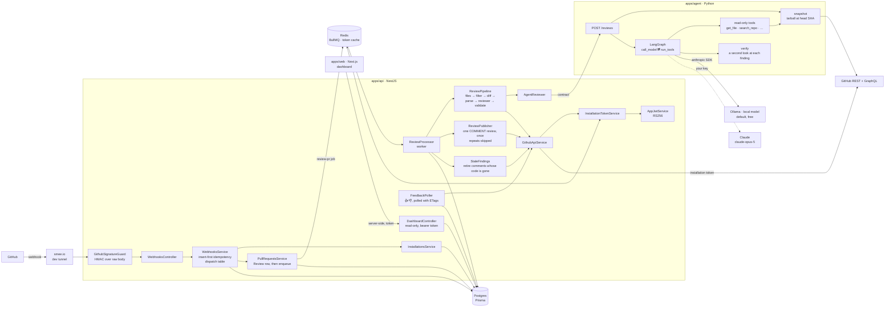

# Architecture

How a pull request becomes a review, hop by hop. The README has the short version.



**A delivery:** the signature guard rejects anything unsigned or tampered with a 401. The
controller hands the delivery to `WebhooksService`, which inserts a `WebhookDelivery` row
first — its unique constraint is what makes redeliveries safe — then routes by
`event.action`. Unknown events get a 200 and are recorded as `IGNORED`.

**A pull request:** `PullRequestsService` writes a `PENDING` `Review` for the head commit
(unique per repo, PR and SHA) and enqueues a job carrying only its ID; the webhook returns. The worker opens a Check Run
and runs `ReviewPipeline`: list the changed files, filter them, fetch the diff between the
review's exact base and head SHAs, parse it, filter again, then ask the reviewer.

**The agent:** `AgentReviewer` posts the reviewable files and a fresh installation token to
the agent (`contracts/` holds the request and response both test suites check). The agent
downloads the repository at the head SHA, then loops between the model and its tools until
the model calls `submit_review`, then checks every finding again in a fresh conversation and
drops the ones the code disproves. Everything from the PR is treated as data, never
instructions; the tools only read. Ollama serves the same Messages API as Claude, so one
SDK client and one graph drive either; Claude's extra features (adaptive thinking, prompt
caching, strict tools) are used only when the model is Claude.

**Back in the API:** the answer is stored, validated against the line map, and written as
`Finding` rows — each one near code an earlier review already commented on is marked a repeat.
Findings at or above the posting bar that aren't repeats are posted as one GitHub review;
earlier comments whose code has changed, and whose problem wasn't found again, are resolved and
collapsed; the Check Run is completed with the summary; the review is marked `COMPLETED`. Each
step records that it happened, so a retry after a failure part-way through picks up where it
stopped.

**Afterwards:** a scheduled job polls 👍 and 👎 on the App's comments into `Feedback`, and the
dashboard reads everything back through a read-only API.

## Code layout

```
apps/api/                     NestJS: webhooks, queue, worker, GitHub, posting
├── Dockerfile                the hosted API's image
├── prisma/                   schema, migrations, and demo/data.json (the demo's seed)
├── src/
│   ├── guards/               webhook signature verification
│   ├── webhooks/             endpoint, idempotency, dispatch
│   ├── installations/        installation lifecycle handlers
│   ├── reviews/              pull_request → Review + job; worker, pipeline, publisher, repeats,
│   │                         stale comments, the per-PR lock, Check Run
│   ├── diff/                 unified diff parser and the line map
│   ├── filters/              which files are reviewed, and PR size limits
│   ├── reviewer/             Reviewer interface, AgentReviewer, stub, finding validation
│   ├── github/               App JWT, installation tokens, API client (REST and GraphQL), redaction
│   ├── feedback/             reactions polled into Feedback, and the feedback rate
│   ├── dashboard/            the read-only dashboard API, its token guard, JSON-safe output
│   ├── queue/                BullMQ connection
│   ├── health/               /healthz
│   ├── prisma/ redis/        clients as Nest providers
│   ├── evals/                fixtures, scoring, the report, the stamp
│   └── scripts/              prove:*, review:stats, capture:fixtures, eval, eval:fixture, eval:check,
│                             demo:export, demo:seed
└── test/                     e2e suites, fixtures, helpers
apps/agent/                   Python: the review agent
├── src/pr_agent/
│   ├── agent/                LangGraph graph, prompt, submit_review, the second look, pricing
│   ├── repo/                 repository snapshot and read-only tools
│   └── main.py               POST /reviews
├── ollama/Modelfile          the local model, with a context window big enough for a review
├── evals/verify/             findings of known truth, for measuring the second look
├── scripts/                  replay.py (a review offline), verify_eval.py (the second look, measured)
└── tests/
apps/web/                     Next.js: the dashboard
├── app/                      overview, reviews, a review, installations
├── components/               the funnel, the daily chart, severity and verdict tags
├── lib/                      the server-only API client, formatting, the funnel
└── scripts/smoke.mjs         every page against a fake API
contracts/                    the API ↔ agent request and response
docs/decisions.md             why things are the way they are
docs/evals/                   the measured report, and the planted bugs' answer key
docs/journal/                 the build journal: the roadmap and each milestone's notes
evals/fixtures/               29 pull requests with known answers
evals/runs/                   committed evaluation runs: results, judgments, report
.github/workflows/            api, agent, web, the eval gate, and the demo's keep-alive
render.yaml                   the hosted demo on Render: the API and its queue
```
